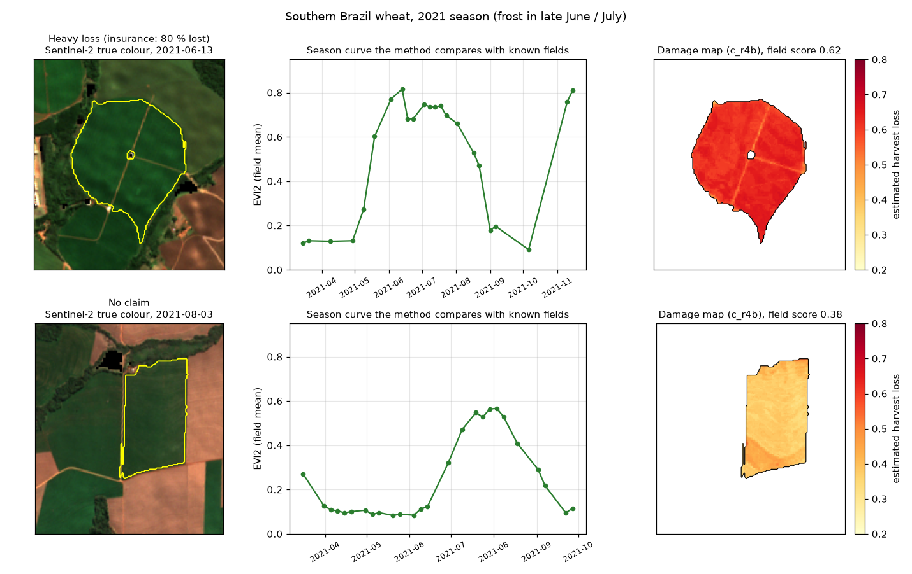

# Tutti Frosti: frost damage maps from satellite images

This project makes **frost damage maps of crop fields** from Sentinel-2 satellite images alone, and ranks fields by
how much harvest they lost.
It was built and tested on wheat fields in southern Brazil, using the Brazilian public crop-insurance records
(PSR, 2016-2024) as ground truth.



*Two wheat fields from 2021. Top: the insurance paid for an 80 % loss, and the map shows high damage across the field.
Bottom: no claim was filed, and the map stays low. The method did not see either field's label (it was trained on other years).
The scores are for ranking fields, so read the colours as more or less damage. They are not exact loss percentages.*

## Starting idea: predict the healthy EVI2 curve (baseline)

My first idea was to **predict the EVI2 vegetation index a healthy field would have had** and to read damage as the
gap between the predicted and the observed EVI2 after a frost night. This was the project's baseline
(`methods/evi2_gpr`, a Gaussian-process prediction per pixel). Simple EVI2 and moisture-index (NDMI) rules were kept as
baselines in the final comparison.

## Workflow: AI agents in a loop

Instead of hand-designing one method, I set up a fixed test and let AI agents search for better methods:

1. **Data.** About 400 insured wheat fields: field outlines matched to insurance policies, with the full Sentinel-2 season
   for each field (10 bands, 10 m). The label is the relative harvest loss paid by the insurance. A field with no claim only
   tells us the loss was below about 35 %.
2. **Fixed rules.** Each method must output a **damage map** (loss from 0 to 1 per pixel). The score of a field is the
   mean of its map. Methods get **no weather data**, so damage must be found from the satellite images alone.
   30 % of the fields are locked away (the *lockbox*) and are used only once, at the very end.
3. **The loop.** Each round, two agents try to beat the current best method (the *champion*). One improves the
   champion; the other tries a completely new idea. A fixed scoring script decides who wins: do fields that lost more
   get higher scores? A candidate becomes champion only if it is better in at least 95 % of bootstrap resamples.
   The loop ran for 7 rounds and tried about 15 methods (`competition/attempts.md`).
4. **Final test.** The best methods were scored once on the lockbox, and later on a second, fresh set of 99 fields.

## The method explained: season analogues (`c_r4b`)

This is one of the best methods, and it is the easiest to explain.
The idea: **a damaged field's season looks like the seasons of other fields that were damaged.**

In short: every pixel of a new field is compared with a library of fields whose insurance result is known.
The most similar fields "vote" with their losses, and the average of their losses is the pixel's damage value.

1. **Make a season curve for every pixel.** For each pixel, take the reflectance in all 10 Sentinel-2 bands on every
   clear date and place it on a common calendar (every 8 days, from early April to mid-November). The result is a
   short "film" of how that pixel greened up, peaked and ripened.
2. **Keep a library of known fields.** For every training field, the library stores one curve (the average over the whole
   field) and its insurance result: the paid loss, or 0.15 for "no claim" (0.85 when a loss was paid but the amount is unknown).
3. **Compare with flexible timing.** Each pixel's curve is compared with every field in the library using *dynamic time
   warping*. This lets the curves shift up to ±48 days, so a field sown three weeks later can still match a field with
   the same shape of season.
4. **Average the 40 most similar fields.** The pixel's damage value is the average loss of the 40 closest library fields.
   The pixel is not put into a group; it gets a number.
5. **Field score** = mean over all pixels of the field.

No model weights are trained: the labels enter only through the library. Code: `methods/c_r4b/`.

### Limitations

- **Many design choices were tested on the development fields** (bands, curve type, calendar, the ±48 days, the 40
  neighbours), and about 15 methods were compared there. The development score is therefore optimistic; the held-out
  scores are the honest numbers.
- **The map is not checked at pixel level.** The library holds whole-field curves and the labels are whole-field
  insurance results, and only the field average was scored. A pixel's value says "this pixel looks like fields that lost
  X"; differences inside a field can also come from edges, soil or sowing.
- **It is not frost-specific.** The whole season shape is matched, so the method can also pick up things that go along
  with claims: region, sowing date, variety, drought or a bad year. Leaving whole years out during development and
  the within-year score (0.700) reduce this, but do not rule it out.
- **Labels are partly imputed.** "No claim" only means the loss was below about 35 %, set to 0.15; paid fields with an
  unknown amount are set to 0.85. The scores are therefore compressed and are only good for ranking fields.
- **Same-season fields in the library on the held-out tests.** During development, fields from the year being scored
  were left out of the library. On both held-out tests, the library held all development fields, including fields of
  the same season that may be nearby and hit by the same frost. In real use, this season's insurance results would not
  be known yet when the map is made.

## Results

Concordance C: the share of field pairs ranked in the right order (0.5 = random, 1 = perfect).

| Method | Development (275 fields) | Lockbox (116 fields) | Fresh set (99 fields) |
|---|---|---|---|
| Final champion `c_r6a` (analogues + ridge blend) | 0.711 | 0.694 | 0.616 |
| **Season analogues `c_r4b`** | **0.705** | **0.683** | **0.615** |
| Baseline: low EVI2 peak | 0.480 | 0.448 | 0.508 |
| Baseline: NDMI drop | 0.434 | 0.505 | 0.495 |
| Baseline: coldest night (ERA5 weather) | 0.489 | 0.510 | 0.500 |

The agent-built methods rank fields clearly better than the simple baselines, which are close to random.
The drop on the fresh set shows the methods are not yet stable across new fields.

## Status: prototype

This is a **prototype and the final result of this phase**. The methods can still be improved, and more labelled fields
(more years, regions and crops) would most likely help most, since the analogue method improves directly as the
library grows. I cannot continue the search for now because of storage and computing limits: the satellite data
alone takes tens of gigabytes.

## Repository

| Path | Content |
|---|---|
| `competition/` | test frame (`FRAME.md`), loop rules (`LOOP.md`), scoring script, baselines, attempt log, scores |
| `methods/` | all methods; `c_r*` = agent methods by round, `c_r4b` = the method above, `evi2_gpr` = EVI2 baseline |
| `validation/brazil_psr/` | insurance data reader, field-outline matching, Sentinel-2 download |
| `data/` | shared Sentinel-2 download and QA helpers |
| `scripts/example_figure.py` | makes the figure above |

```
conda env create -f environment.yml && conda activate frostmap
python -m competition.score dev c_r4b      # score a method on the development fields
```

The field data package (about 3 GB) and the raw insurance records are not in this repository: the records contain
personal data (names, tax IDs, exact locations). They are public from the Brazilian Ministry of Agriculture
(SISSER / PSR open data, CC-BY) and can be rebuilt with `validation/brazil_psr/`.

## Note on AI use

This project was vibe-coded: the code was written with AI coding assistants. AI was used only for writing code and
in the exploration phase, where agents searched for ways to define and recognise damage. The project idea, the data
choices, the test rules and the decisions were my own.
